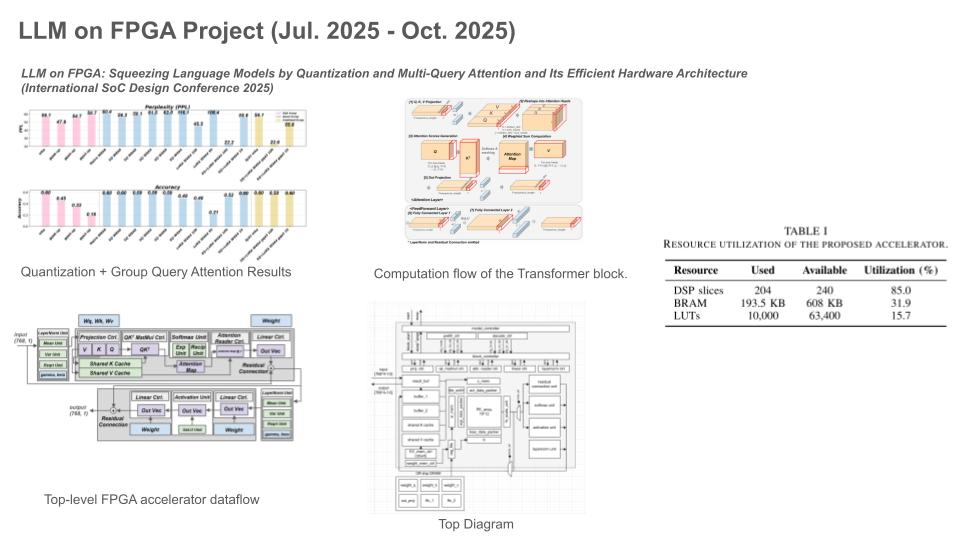
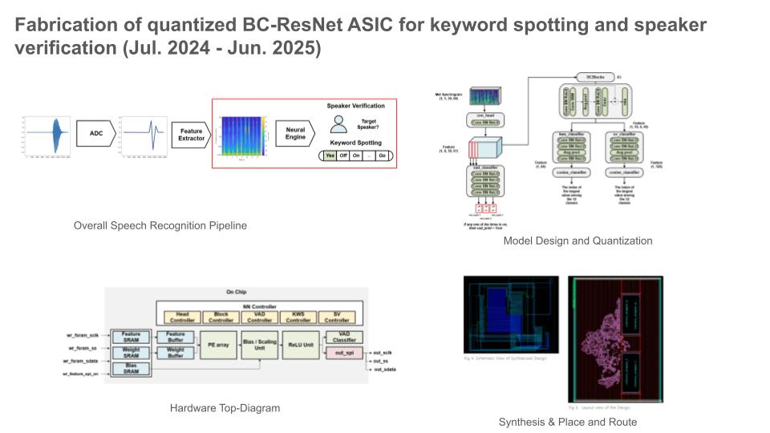
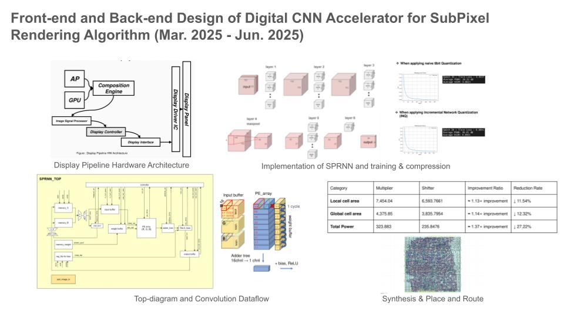

My research includes algorithmic optimization and hardware implementations of Convolutional Neural Networks (CNNs) and LLMs. 
For algorithm level, I worked on KV-cache compression for long-context reasoning tasks of LLMs and CUDA kernel development for efficient LLM inference.  
For hardware level, I worked on implementation of Verilog RTL codes and verification of ML Hardware Accelerator. I also contributed to the Tape-Out (Synthesis and Place-and-Route) of CNN accelerator ASIC and LLM deployment on FPGA. 

# 📦 Algorithm Level

## KV-cache quantization and GPU inference
- Developed adaptive KV-cache quantization and tile-level precision control for LLM inference, co-designing quantization policies with memory bandwidth and hardware dataflow constraints to reduce KV memory traffic while preserving model quality.

## CUDA Kernel Development for Fast Matrix Multiplication
- Built optimized CUDA kernels for LLM inference leveraging block tiling, vectorized memory access, shared-memory reuse, warp-level tiling, and Tensor Core WMMA instructions. Reached near-PyTorch training/inference performance. [link](https://chae-sy.github.io/CUDA-MatMul)

---
# 📦 Algorithm-Hardware Co-Design
## FPGA LLM deployment

- Implemented Multi-Query Attention and W4A4 for FPGA LLM deployment; designed RTL in SystemVerilog for Transformer blocks; conducted synthesis and bitstream generation for FPGA implementation in Xilinx Vivado. [link](https://chae-sy.github.io/LLM-on-FPGA/)

---

# 📦 Hardware & Circuit Level
## Tape-out of CNN Accelerator for Keyword Spotting and Speaker Verification ASIC

- Fine-tuned CNN keyword-spotting (KWS) models for hardware-friendly deployment using framewise incremental computation scheme; designed Verilog RTL blocks for efficient CNN operations. Participated in the Multi-Project Wafer (MPW) program for undergraduate and graduate students organized by IDEC and contributed to the tape-out of KWS ASIC tape-out. [link](https://chae-sy.github.io/CNN-Tape-Out/)

- conducted fully fixed-point integer-Quantization of BC-ResNet for keyword spotting (KWS) and speaker-verification(SV) embeddings; implemented PTQ/QAT (CLE, bias correction, AWQ, SmoothQuant, PACT). Participated in the Multi-Project Wafer (MPW) program organized by IDEC and contributed to KWS and SV ASIC tape-out. [link](https://chae-sy.github.io/Quantized-BC-ResNet-Tape-Out/)

## Capstone Design Project on CNN Hardware Accelerator for SubPixel Rendering

[link](https://chae-sy.github.io/Capstone-Design/)

- Led a team of four undergraduates to train a CNN-based subpixel rendering algorithm, optimizing network parameters using Incremental Network Quantization.

- Designed its hardware accelerator in Verilog: developed a pipelined structure and verified its functionality.

- Executed the full digital ASIC tape-out flow, including RTL synthesis, timing-driven place-and-route, power and timing sign-off, and final GDSII generation. Awarded Engineering Innovation Prize.

---
# 📦 Others: Intelligent Sensing and Fault Diagnosis

[link](https://chae-sy.github.io/Smart-Factory/)
- Developed a 1D-CNN LSTM–based fault diagnosis system for rotating machinery using vibration and acoustic signals, achieving up to 97.4% classification accuracy across multiple fault conditions.

- Utilized time-series feature extraction and sequence learning techniques to detect mechanical anomalies such as mechanical looseness, improving predictive maintenance capability.

